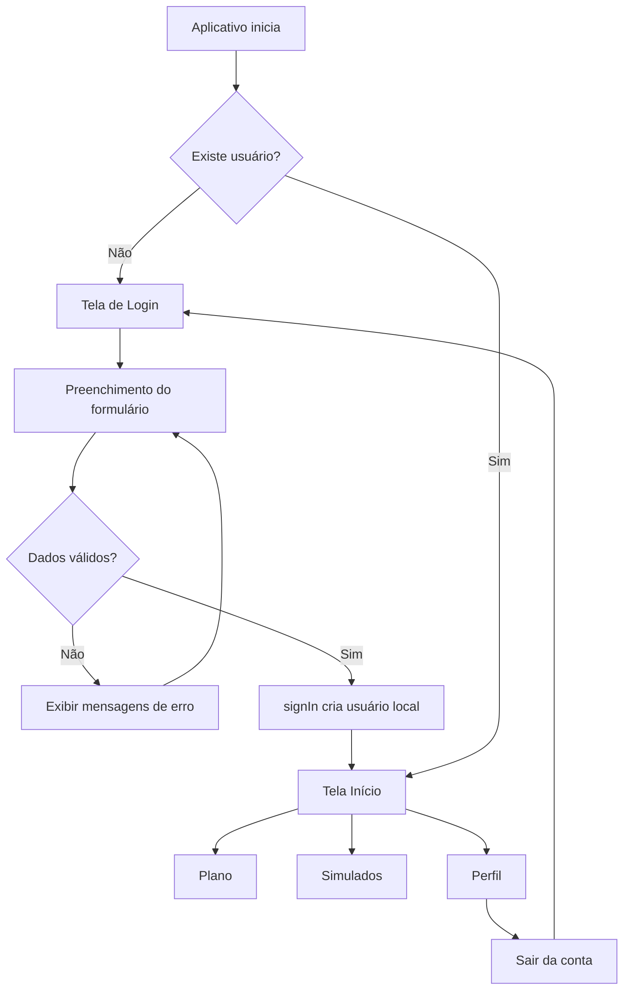

# Vision Mobile

Aplicativo mobile educacional para organização de estudos e preparação para o ENEM. O projeto apresenta uma experiência completa de autenticação, acompanhamento de progresso, planejamento semanal, simulados e perfil do estudante.

A aplicação foi construída com **React Native**, **Expo**, **Expo Router**, **TypeScript** e **NativeWind**. Ela pode ser executada no Android, iOS e navegador.

> Este diretório contém somente o aplicativo mobile. Ele fica dentro da pasta `mobile/` do projeto principal Vision.

## Link do projeto no GitHub

**Link para entrega:** `INSERIR_AQUI_O_LINK_DO_REPOSITORIO`

O repositório local ainda não possui um remote Git configurado. Antes de entregar o trabalho, crie um repositório no GitHub, substitua o texto acima pelo link real e publique o projeto:

```bash
git add .
git commit -m "feat: adiciona aplicativo mobile Vision"
git branch -M main
git remote add origin https://github.com/SEU_USUARIO/NOME_DO_REPOSITORIO.git
git push -u origin main
```

Se o remote já tiver sido configurado posteriormente, confira o endereço com:

```bash
git remote -v
```

## Objetivo do aplicativo

O Vision Mobile foi pensado para ajudar estudantes a manter uma rotina de estudos organizada. A interface apresenta informações que permitem responder rapidamente a perguntas como:

- O que preciso estudar hoje?
- Quanto da minha meta semanal já concluí?
- Em quais matérias estou evoluindo?
- Quais simulados estão disponíveis?
- Qual é a minha sequência atual de estudos?

A versão atual funciona como um protótipo navegável. Os dados são demonstrativos e a autenticação é simulada localmente, sem comunicação com um servidor.

## Requisitos da avaliação

| Requisito | Pontuação | Como foi atendido |
| --- | ---: | --- |
| Pelo menos quatro telas, sendo uma de autenticação | 3 pontos | Foram desenvolvidas cinco telas: Login, Início, Plano, Simulados e Perfil. |
| Formulário com validação | 2 pontos | O Login valida e-mail obrigatório, formato do e-mail, senha obrigatória e mínimo de seis caracteres. |
| Layout visual elaborado | 3 pontos | O aplicativo possui identidade visual própria, cartões, indicadores de progresso, calendário, ícones, estados interativos e hierarquia tipográfica. |
| Organização e estrutura | 1 ponto | Rotas, componentes, contexto, dados, tokens e validações foram separados por responsabilidade. |
| Navegação simples com Stack | 1 ponto | O layout raiz utiliza `Stack` para controlar o fluxo entre autenticação e aplicação. As telas internas também utilizam abas para facilitar o uso. |

## Telas desenvolvidas

### 1. Login — autenticação

Arquivo: `src/app/(auth)/login.tsx`

É a primeira tela apresentada quando não existe um usuário autenticado.

A tela contém:

- campo de e-mail;
- campo de senha;
- botão para mostrar ou ocultar a senha;
- link visual de recuperação de senha;
- mensagens de validação abaixo dos campos;
- botão com estado de carregamento;
- redirecionamento para a tela Início após o login;
- adaptação do teclado com `KeyboardAvoidingView`;
- área segura com `SafeAreaView`.

Para testar o login, pode ser usado qualquer e-mail válido e qualquer senha com seis ou mais caracteres.

Exemplo:

```text
E-mail: aluno@vision.com
Senha: vision123
```

A autenticação é demonstrativa. O método `signIn` aguarda alguns milissegundos para simular uma requisição e cria um usuário local chamado Ana.

### 2. Início — painel do estudante

Arquivo: `src/app/(tabs)/inicio.tsx`

É o painel principal depois da autenticação. Ele apresenta uma visão rápida da rotina do estudante:

- saudação personalizada com o nome do usuário;
- meta semanal para o ENEM;
- indicador circular de 68% de progresso;
- card para continuar a última aula;
- progresso da aula atual;
- agenda do dia;
- atividades concluídas e pendentes;
- desempenho separado por área do conhecimento;
- atalhos para o Plano de estudos.

A tela reutiliza os componentes `PageHeader`, `ProgressBar`, `Screen`, `SectionTitle` e `Icon`.

### 3. Plano — organização semanal

Arquivo: `src/app/(tabs)/plano.tsx`

Esta tela representa o cronograma de estudos do aluno.

Funcionalidades demonstradas:

- identificação da semana atual;
- seletor visual dos dias da semana;
- alteração do dia selecionado;
- resumo do progresso semanal;
- lista de atividades do dia;
- atividades com comportamento de checkbox;
- contador de tarefas concluídas;
- recomendação personalizada da Vision IA.

As atividades são armazenadas em um estado local:

```tsx
const [completed, setCompleted] = useState<string[]>(['1']);
```

Ao tocar em uma atividade, o identificador é adicionado ou removido da lista. A interface muda imediatamente e o contador, por exemplo, passa de `1/3 concluídas` para `2/3 concluídas`.

### 4. Simulados — prática e desempenho

Arquivo: `src/app/(tabs)/simulados.tsx`

A área de simulados contém:

- destaque do simulado da semana;
- data e horário da próxima prova;
- botão de participação com confirmação;
- filtros entre Todos, ENEM e Por matéria;
- lista de simulados disponíveis;
- quantidade de questões;
- duração e dificuldade;
- simulado em andamento com barra de progresso;
- média geral do estudante;
- quantidade de simulados realizados.

Os filtros utilizam `useState` para controlar qual opção está selecionada. Os botões dos simulados apresentam mensagens usando `Alert.alert`.

### 5. Perfil — dados do estudante

Arquivo: `src/app/(tabs)/perfil.tsx`

A tela de perfil reúne:

- nome e e-mail do usuário autenticado;
- avatar;
- identificação do plano;
- total de horas estudadas;
- quantidade de questões;
- sequência de estudos;
- meta semanal;
- acompanhamento dos dias estudados;
- opções de conta e preferências;
- botão para sair da conta.

Ao tocar em “Sair da conta”, um alerta solicita confirmação. Depois da confirmação, o usuário é removido do contexto e a navegação retorna para o Login.

## Formulário e validação

As regras do formulário foram separadas da interface no arquivo:

`src/lib/validation.ts`

A função `validateLogin` recebe o e-mail e a senha e devolve um objeto com os erros encontrados:

```ts
export function validateLogin(email: string, password: string): LoginErrors {
  const errors: LoginErrors = {};

  if (!email.trim()) {
    errors.email = 'Informe seu e-mail.';
  } else if (!emailPattern.test(email.trim())) {
    errors.email = 'Digite um e-mail válido.';
  }

  if (!password) {
    errors.password = 'Informe sua senha.';
  } else if (password.length < 6) {
    errors.password = 'A senha precisa ter pelo menos 6 caracteres.';
  }

  return errors;
}
```

Validações implementadas:

1. O e-mail não pode estar vazio.
2. O e-mail precisa possuir um formato válido.
3. A senha não pode estar vazia.
4. A senha precisa possuir pelo menos seis caracteres.
5. O formulário não realiza o login enquanto existirem erros.
6. A mensagem de um campo desaparece quando o usuário volta a digitá-lo.

Fluxo executado no envio:

```tsx
const nextErrors = validateLogin(email, password);
setErrors(nextErrors);

if (Object.keys(nextErrors).length > 0) return;

await signIn(email.trim().toLowerCase());
router.replace('/inicio');
```

## Navegação com Expo Router

O Expo Router cria as rotas a partir da estrutura de arquivos.

### Stack principal

Arquivo: `src/app/_layout.tsx`

O layout raiz utiliza o componente `Stack` do Expo Router:

```tsx
<Stack
  screenOptions={{
    headerShown: false,
    animation: 'fade',
    contentStyle: { backgroundColor: '#F4F7EF' },
  }}
/>
```

Esse Stack controla o fluxo principal:

```text
Inicialização → Login → Aplicação
                    ↘ Início
                    ↘ Plano
                    ↘ Simulados
                    ↘ Perfil
```

O arquivo `src/app/index.tsx` verifica o estado de autenticação:

- sem usuário: redireciona para `/login`;
- com usuário: redireciona para `/inicio`.

### Grupos de rotas

Os parênteses organizam as rotas sem alterar o endereço mostrado:

- `(auth)`: contém as telas relacionadas à autenticação;
- `(tabs)`: contém as telas principais da aplicação.

### Navegação por abas

Arquivo: `src/app/(tabs)/_layout.tsx`

Depois do login, o estudante navega por uma barra inferior com quatro opções:

- Início;
- Plano;
- Simulados;
- Perfil.

O layout das abas também protege as rotas. Se não existir usuário autenticado, ele retorna um `Redirect` para `/login`.

A navegação interna por abas complementa o Stack solicitado na avaliação. O Stack controla o fluxo geral e as Tabs tornam as quatro áreas principais mais acessíveis.

## Fluxo de autenticação

O estado do usuário fica no arquivo `src/context/auth-context.tsx`.

O `AuthProvider` envolve todas as rotas no layout raiz e disponibiliza:

- `user`: usuário atual ou `null`;
- `signIn(email)`: simula o login;
- `signOut()`: encerra a sessão;
- `useAuth()`: hook usado pelas telas.

Fluxo completo:



Como o estado está somente em memória, recarregar completamente o aplicativo encerra a sessão. Em uma versão de produção, o contexto poderia ser integrado a uma API e ao armazenamento seguro do dispositivo.

## Layout e identidade visual

O visual foi inspirado em interfaces modernas de educação e produtividade, seguindo a proposta de pesquisa de referências de aplicativos.

A identidade visual reaproveita a linguagem da marca Vision:

- verde-lima para ações, progresso e conclusão;
- preto e carvão para áreas de destaque;
- fundo mineral claro para reduzir o cansaço visual;
- superfícies brancas para agrupar informações;
- cantos arredondados para uma aparência amigável;
- tipografia com pesos fortes para criar hierarquia;
- cards de progresso, calendário e estatísticas;
- ícones adaptados para Android, iOS e web;
- feedback visual ao pressionar botões;
- estados diferentes para itens ativos, concluídos e com erro.

### Paleta principal

Os tokens ficam em `src/constants/design.ts` e `tailwind.config.js`.

| Token | Cor | Uso |
| --- | --- | --- |
| `vision-green` | `#A6FF00` | Botões, progresso e conclusão |
| `vision-deep` | `#4E7600` | Textos de destaque em fundo claro |
| `vision-black` | `#10130E` | Cards escuros e textos principais |
| `vision-ink` | `#252A21` | Variação de texto escuro |
| `vision-gray` | `#697064` | Textos secundários |
| `vision-light` | `#F4F7EF` | Fundo principal |
| `vision-line` | `#DDE4D7` | Bordas e divisores |

### NativeWind

O NativeWind permite usar classes inspiradas no Tailwind CSS diretamente nos componentes React Native:

```tsx
<View className="rounded-[26px] border border-vision-line bg-white p-4">
  <Text className="text-lg font-extrabold text-vision-black">
    Conteúdo do card
  </Text>
</View>
```

Arquivos envolvidos na configuração:

- `tailwind.config.js`: arquivos monitorados e tokens da Vision;
- `babel.config.js`: transformação JSX do NativeWind;
- `metro.config.js`: integração do NativeWind com o Metro;
- `src/global.css`: diretivas do Tailwind;
- `nativewind-env.d.ts`: tipos do NativeWind para TypeScript.

## Componentes reutilizáveis

Os componentes compartilhados evitam repetição e mantêm o visual consistente.

| Componente | Responsabilidade |
| --- | --- |
| `BrandMark` | Símbolo e nome da Vision |
| `Icon` | Padronização de ícones entre plataformas |
| `Screen` | Área segura, fundo, rolagem e largura máxima |
| `PageHeader` | Título, texto auxiliar e notificações |
| `SectionTitle` | Títulos e ações das seções |
| `ProgressBar` | Barra de progresso reutilizada nas telas |

## Dados demonstrativos

O arquivo `src/data/study.ts` concentra os dados usados pelas interfaces:

- atividades da agenda;
- progresso por matéria;
- lista de simulados.

Separar os dados evita colocar listas grandes diretamente nas telas e facilita uma futura substituição por respostas de uma API.

## Estrutura de pastas

```text
mobile/
├── assets/                         imagens e ícones do Expo
├── src/
│   ├── app/
│   │   ├── _layout.tsx             Stack principal e providers
│   │   ├── index.tsx               redirecionamento inicial
│   │   ├── (auth)/
│   │   │   └── login.tsx           autenticação e formulário
│   │   └── (tabs)/
│   │       ├── _layout.tsx         navegação inferior
│   │       ├── inicio.tsx          painel principal
│   │       ├── plano.tsx           cronograma semanal
│   │       ├── simulados.tsx       provas e desempenho
│   │       └── perfil.tsx          usuário, metas e logout
│   ├── components/
│   │   ├── brand-mark.tsx
│   │   ├── icon.tsx
│   │   ├── page-header.tsx
│   │   ├── progress-bar.tsx
│   │   ├── screen.tsx
│   │   └── section-title.tsx
│   ├── constants/
│   │   └── design.ts               paleta da aplicação
│   ├── context/
│   │   └── auth-context.tsx        estado de autenticação
│   ├── data/
│   │   └── study.ts                dados demonstrativos
│   ├── lib/
│   │   └── validation.ts           regras do formulário
│   └── global.css                  entrada do NativeWind
├── app.json                        configurações do Expo
├── babel.config.js                 configuração do Babel
├── metro.config.js                 configuração do Metro
├── nativewind-env.d.ts             tipos do NativeWind
├── package.json                    dependências e comandos
├── tailwind.config.js              tema e tokens visuais
└── tsconfig.json                   configuração TypeScript
```

## Tecnologias utilizadas

| Tecnologia | Finalidade |
| --- | --- |
| Expo SDK 57 | Ambiente de desenvolvimento e execução |
| React Native | Construção da interface mobile |
| React 19 | Componentes e gerenciamento de estado |
| Expo Router | Navegação baseada em arquivos |
| NativeWind | Estilização com classes utilitárias |
| Tailwind CSS | Tema e tokens utilizados pelo NativeWind |
| TypeScript | Tipagem estática e segurança do código |
| Expo Symbols | Ícones adaptados para cada plataforma |
| Safe Area Context | Respeito a recortes e barras do dispositivo |
| Gesture Handler | Base para gestos e navegação |

## Pré-requisitos

Antes de executar, é necessário ter:

- Node.js instalado;
- npm instalado;
- Expo Go no celular, caso seja utilizado um dispositivo físico;
- Android Studio, caso seja utilizado um emulador Android;
- macOS e Xcode para executar localmente no simulador iOS.

## Instalação

Na raiz do repositório:

```bash
cd mobile
npm install
```

## Como executar

Iniciar o servidor do Expo:

```bash
npm start
```

Depois que o terminal do Expo abrir:

- pressione `a` para executar no Android;
- pressione `i` para executar no iOS, disponível no macOS;
- pressione `w` para executar no navegador;
- escaneie o QR Code com o Expo Go para testar em um celular.

Também é possível iniciar diretamente:

```bash
npm run android
npm run ios
npm run web
```

## Comandos disponíveis

| Comando | Descrição |
| --- | --- |
| `npm start` | Inicia o servidor de desenvolvimento do Expo |
| `npm run android` | Abre o projeto no Android |
| `npm run ios` | Abre o projeto no iOS |
| `npm run web` | Abre a versão web |
| `npm run lint` | Executa a análise de lint do Expo |
| `npx tsc --noEmit` | Verifica os tipos sem gerar arquivos |
| `npx expo install --check` | Confere a compatibilidade das dependências |
| `npx expo export --platform web` | Gera a exportação estática web |

## Como demonstrar o projeto

Uma apresentação simples pode seguir esta ordem:

1. Explique que o aplicativo ajuda na organização dos estudos para o ENEM.
2. Mostre a estrutura de pastas e o funcionamento das rotas por arquivo.
3. Abra o aplicativo na tela de Login.
4. Tente enviar o formulário vazio para mostrar as mensagens obrigatórias.
5. Digite um e-mail inválido para mostrar a validação de formato.
6. Digite uma senha curta para mostrar a validação de quantidade de caracteres.
7. Entre com dados válidos.
8. Apresente a tela Início e os indicadores de progresso.
9. Abra o Plano e marque uma atividade como concluída.
10. Mostre os filtros e cards da tela Simulados.
11. Apresente as metas e estatísticas no Perfil.
12. Use o botão “Sair da conta” para demonstrar o retorno ao Login.
13. Explique o `AuthContext`, a função `validateLogin`, o Stack principal e as Tabs.
14. Finalize explicando que os dados ainda são locais e podem ser conectados a uma API futuramente.

## Decisões de organização

A estrutura foi dividida por responsabilidade:

- telas cuidam da composição e interação de cada rota;
- componentes cuidam de elementos visuais reutilizáveis;
- contexto cuida do estado global de autenticação;
- validação fica fora da tela para facilitar testes e manutenção;
- dados demonstrativos ficam separados da interface;
- tokens evitam repetir cores em diversos arquivos;
- grupos do Expo Router separam autenticação e área interna.

Essa organização permite adicionar novas telas e integrar uma API sem precisar reescrever toda a interface.

## Acessibilidade e adaptação

Foram adicionados:

- rótulos de acessibilidade nos campos e botões principais;
- papéis como `button` e `checkbox`;
- estado marcado nas atividades;
- mensagens de erro próximas aos respectivos campos;
- áreas seguras para evitar sobreposição com recortes do aparelho;
- rolagem vertical em telas com muito conteúdo;
- ajuste de teclado na tela de Login;
- largura máxima para melhorar a visualização no navegador e em tablets;
- ícones específicos para iOS, Android e web.

## Limitações atuais

Esta entrega é um protótipo acadêmico navegável. Atualmente:

- a autenticação não consulta uma API;
- a sessão não é persistida ao fechar ou recarregar o aplicativo;
- os dados de estudos e simulados são demonstrativos;
- alguns botões representam ações futuras ou exibem apenas alertas;
- não existe cadastro de usuário;
- não existe armazenamento em banco de dados;
- não existem notificações push.

Esses pontos não impedem a demonstração dos requisitos da avaliação. Eles indicam caminhos naturais para uma próxima versão.

## Possíveis melhorias futuras

- integração com uma API real;
- persistência da sessão com armazenamento seguro;
- cadastro e recuperação de senha;
- resolução completa dos simulados;
- sincronização do plano de estudos;
- notificações de atividades;
- modo escuro;
- testes unitários para as validações;
- testes E2E automatizados;
- publicação nas lojas Android e iOS.

## Verificações realizadas

Durante o desenvolvimento foram executadas as seguintes verificações:

- validação de tipos com TypeScript;
- verificação de compatibilidade das dependências do Expo;
- exportação estática da versão web;
- teste do fluxo de Login;
- teste das mensagens de validação;
- teste de navegação entre as quatro telas internas;
- teste de marcação de atividades no Plano;
- inspeção em viewport mobile de 390 × 844;
- verificação do console sem erros.

## Autor

**Nome do aluno:** `PREENCHER_NOME_DO_ALUNO`

**Curso/Disciplina:** `PREENCHER_CURSO_E_DISCIPLINA`

**Professor:** `PREENCHER_NOME_DO_PROFESSOR`

**Data de entrega:** `PREENCHER_DATA`

